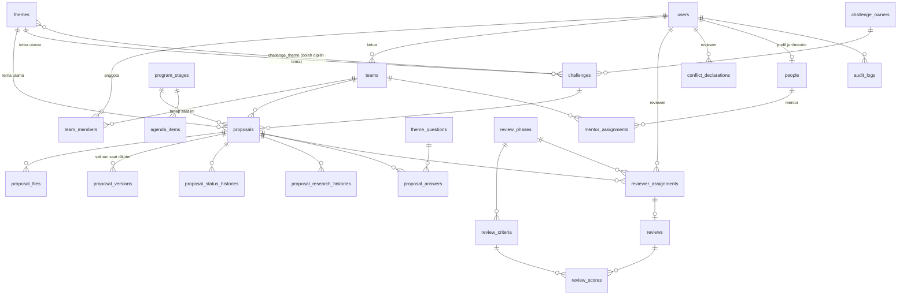
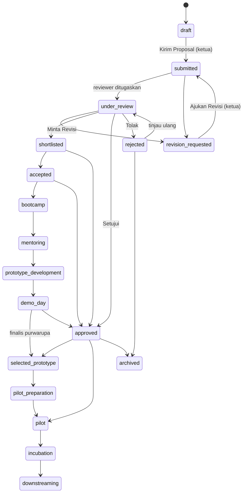

# Arsitektur DEEPNEST

## 1. Relasi data

Tabel konten: `announcements`, `documents`, `pages`, `faqs`, `agenda_items`. Tabel sistem:
`settings` (pengaturan JSON), `audit_logs`, `sessions`, `cache`, `jobs`.

Tahapan 7–11 (pendanaan purwarupa, pilot, inkubasi & hilirisasi, adopsi & dampak, monitoring) sudah ada
di model data sehingga program berlanjut tanpa desain ulang basis data.

## 2. Peran dan hak akses

| Kemampuan | Peserta | Reviewer/Juri | Admin |
| --- | :---: | :---: | :---: |
| Mendaftar sendiri | ✓ | — (dibuat admin) | — (wizard/CLI) |
| Membuat/bergabung tim, kelola anggota | ✓ (ketua) | — | ✓ |
| Menyusun & menyimpan draf proposal tim | ✓ (anggota aktif) | — | — |
| Mengirim proposal / mengajukan revisi | ✓ (ketua, saat Open Call) | — | — |
| Melihat proposal | tim sendiri | hanya yang **ditugaskan** | semua |
| Mengunduh berkas privat | tim sendiri | hanya yang ditugaskan (tanpa telaah internal) | semua |
| Menilai & merekomendasikan | — | ✓ | — |
| Menyatakan konflik kepentingan | — | ✓ | — |
| Menugaskan/mencabut reviewer & mentor | — | — | ✓ |
| Menetapkan status (revisi, terima, setujui, tolak, finalis, tahap) | — | — | ✓ |
| Publikasi: sunting ringkasan, sembunyikan/terbitkan, buka PDF | — | — | ✓ |
| Kelola konten, rubrik, pengaturan, ekspor, log audit | — | — | ✓ |

Otorisasi ditegakkan di server melalui middleware `role:*`, *policy* (`ProposalPolicy`,
`ProposalFilePolicy`, `TeamPolicy`), dan pemeriksaan penugasan — bukan sekadar menyembunyikan tombol.
Kolom `role` dan `is_active` tidak *mass-assignable* sehingga tidak dapat dinaikkan lewat formulir.

## 3. Status proposal

Daftar lengkap transisi ada di `App\Enums\ProposalStatus::adminTransitions()`. Hanya admin yang
mengubah status (kecuali peserta: kirim/ajukan revisi). Setiap perubahan dicatat di
`proposal_status_histories` dan `audit_logs`. Status `published` disediakan untuk kompatibilitas;
publikasi direpresentasikan oleh kolom `is_public`.

Peserta hanya dapat menyunting saat `draft` atau `revision_requested`. Tema/tantangan yang diubah setelah
proposal pernah dikirim (dibuka kembali admin) dicatat sebagai `proposal.theme_changed_after_reopen`.
Setiap pengiriman menaikkan `version` dan menyimpan salinan isian di `proposal_versions`.

## 4. Aturan publikasi produk

1. Admin memilih **Setujui** → `status = approved`, `approved_at`, `approved_by`.
2. Sistem otomatis mengisi ringkasan publik (judul & deskripsi singkat yang ditinjau admin di formulir
   persetujuan), membuat `public_slug`, menyalin gambar sampul ke `public_image_path` (salinan terpisah),
   lalu `is_public = true` dan `published_at = now()`.
3. Kartu dan halaman produk hanya membaca kolom `public_*`; isian privat tidak pernah ditampilkan.
4. `public_pdf_enabled` bawaan **false**; PDF hanya terunduh publik bila admin mengaktifkannya.
5. **Cabut Publikasi** (wajib alasan) → `is_public = false`; halaman dan gambar publik menjadi 404;
   proposal, penilaian, dan audit tetap ada. Produk yang dicabut manual **tidak** tampil lagi otomatis
   saat disetujui ulang; admin perlu memilih **Terbitkan Produk**.
6. Status `rejected`/`archived` otomatis mencabut publikasi.
7. Nama tim/institusi tampil hanya bila `public_show_team` dicentang (bawaan mengikuti Pengaturan,
   awalnya mati). Nama mitra tampil hanya bila mitra ditandai publik.

## 5. Penilaian

- Fase penilaian (`review_phases`) dan kriteria (`review_criteria`: panduan, skor maks., bobot, wajib
  komentar, khusus tema) dapat diatur admin. Seed awal: Seleksi Open Call (9 kriteria) dan
  Demo Day & Technical Review (9 kriteria), masing-masing berbobot total 100%.
- Skor tertimbang 0–100 = Σ(skor ÷ maks × bobot) ÷ Σbobot × 100, dihitung di server
  (`ScoreCalculator`); sama dengan rubrik KAK Σ(skor × bobot) ÷ 5 × 100 untuk skala 1–5.
- Penilaian final terkunci; admin dapat membuka kembali dengan alasan, nilai lama disimpan di audit.
- Rekomendasi reviewer (lanjutkan, lanjutkan dengan syarat, minta revisi, tidak dilanjutkan, konflik)
  bersifat masukan; keputusan akhir oleh admin.
- Konflik kepentingan **diblokir**: reviewer anggota tim, juri yang menjadi mentor tim, konflik yang
  dinyatakan (proposal/tim/institusi). **Peringatan** (perlu konfirmasi admin): institusi sama.

## 6. Klasifikasi data

| Data | Peserta (tim) | Reviewer ditugaskan | Admin | Publik |
| --- | :---: | :---: | :---: | :---: |
| Isian proposal lengkap | ✓ | ✓ | ✓ | — |
| Kontak narahubung (surel/telepon) | ✓ | — | ✓ | — |
| Identitas tim | ✓ | ✓ (— bila review buta) | ✓ | hanya bila diizinkan |
| PDF proposal, lampiran, bukti, dokumen legal | ✓ | ✓ | ✓ | PDF hanya bila dibuka admin |
| Telaah internal/visitasi legal | — | — | ✓ | — |
| Skor, rekomendasi, komentar reviewer | opsional (Pengaturan) | milik sendiri | ✓ | — |
| Catatan pribadi reviewer | — | milik sendiri | ✓ | — |
| Data rahasia tantangan (data, lokasi pilot, kontak) | sesuai tanda publik | sesuai tanda publik | ✓ | hanya bila ditandai publik |
| Ringkasan publik produk (`public_*`) | ✓ | ✓ | ✓ | ✓ bila `is_public` |

## 7. Keamanan berkas

- Validasi ekstensi, MIME, **isi berkas (finfo)**, ukuran, dan dimensi gambar di server.
- Hanya PDF, JPEG, PNG, WebP. Berkas PHP/EXE/SVG atau berkas yang menyamar ditolak.
- Nama penyimpanan acak (40 karakter); nama asli hanya disimpan sebagai metadata yang dibersihkan.
- Gambar ditulis ulang dengan GD (membuang EXIF/GPS dan konten tersisip).
- URL berkas memakai UUID; path penyimpanan tidak pernah dikirim ke HTML.
- Respons berkas: `X-Content-Type-Options: nosniff`, CSP *sandbox*, `Cache-Control: private, no-store`.
- Rute unduhan dibatasi lajunya; akses berkas sensitif tercatat (`file.accessed`, `file.public_pdf_downloaded`).

## 8. Keamanan aplikasi lainnya

- Content-Security-Policy ketat (tanpa skrip inline), `X-Frame-Options`, `Referrer-Policy`,
  `Permissions-Policy`, HSTS saat HTTPS.
- Markdown dirender dengan HTML mentah dibuang dan tautan tidak aman diblokir.
- Ekspor CSV mencegah injeksi formula spreadsheet.
- Pembatasan laju untuk masuk, daftar, lupa kata sandi, gabung tim, unggah, dan unduh.
- Akun nonaktif otomatis dikeluarkan; admin tidak dapat menurunkan/menonaktifkan dirinya sendiri.
